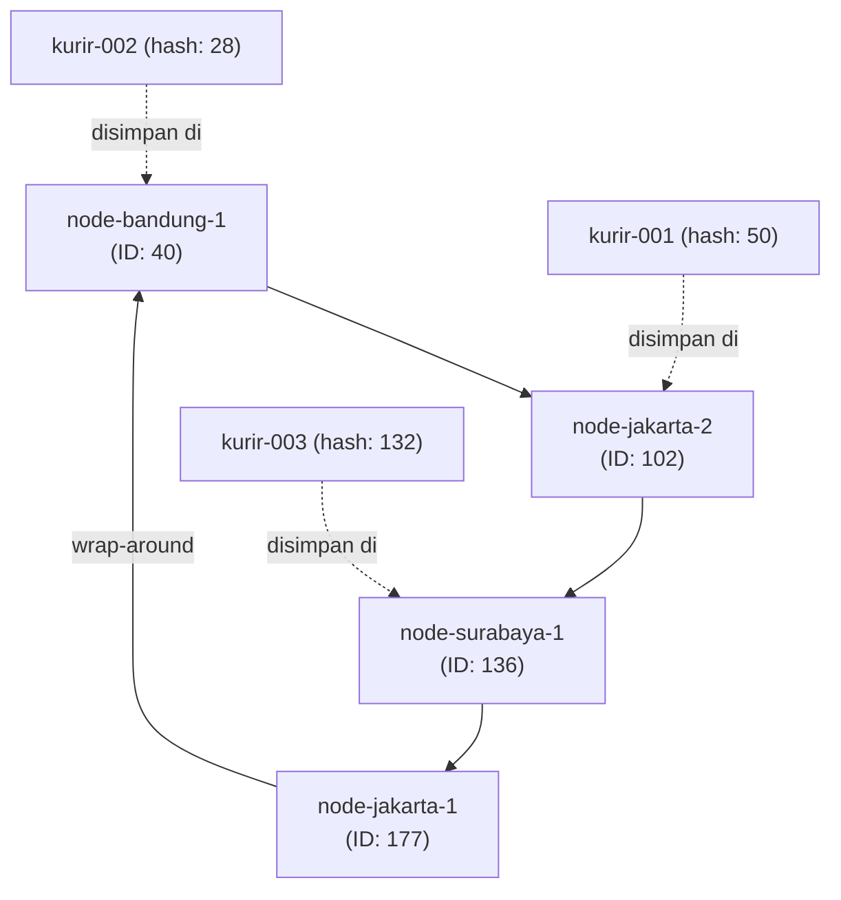

# Tugas 6 (Pekan 6) — Penamaan & Resolusi Lokasi

**Materi terkait:** Flat Naming, Structured Naming (DNS), Distributed Hash Table (DHT)/Chord.

## Studi Kasus

Pelanggan FoodGo kesulitan menemukan alamat IP server kurir yang **dinamis** (kurir berpindah lokasi/jaringan, IP-nya sering berubah). FoodGo butuh cara memetakan **ID Kurir** (identitas tetap) ke **alamat IP terkininya** tanpa server pusat tunggal yang jadi bottleneck/single point of failure.

## Tugas Kelompok

Implementasikan **simulasi Chord DHT** sederhana (single-process, tidak perlu jaringan sungguhan — cukup simulasi struktur data & algoritma di satu program Python) yang memetakan ID Kurir ke alamat IP mereka.

Konsep yang harus terlihat jalan dalam simulasi kalian:
1. **Consistent hashing**: ID Kurir dan ID Node di-hash ke ruang angka yang sama (mis. 0–255 untuk kesederhanaan, `m=8` bit).
2. **Ring topology**: node-node diurutkan melingkar berdasarkan hasil hash-nya.
3. **Lookup**: fungsi `lookup(kurir_id)` yang menemukan node mana yang bertanggung jawab menyimpan mapping ID Kurir tersebut → alamat IP-nya (aturan Chord: node dengan ID hash **terkecil yang lebih besar atau sama dengan** hash key, disebut *successor*).
4. **Perubahan topologi**: simulasikan minimal satu node baru bergabung (`join`) atau satu node keluar (`leave`), tunjukkan bagaimana mapping berpindah tanggung jawab ke node lain.

Skeleton disediakan di `src/chord_simulation.py` dengan fungsi hashing dan struktur ring sudah ada — bagian `lookup()`, `join()`, dan `leave()` sengaja dikosongkan.

### Cara Menjalankan

```bash
python3 src/chord_simulation.py
```

## Tugas Analisis (`README.md`)

1. Jelaskan **kenapa DHT/Chord** lebih cocok untuk kasus ini dibanding **flat naming sederhana** (mis. tabel pusat ID→IP) atau **DNS konvensional** — kaitkan dengan sifat "IP kurir sering berubah" dan kebutuhan tanpa titik gagal tunggal. <br>
Pada studi kasus FoodGo, setiap kurir mempunyai ID kurir yang bersifat tetap (fixed) tetapi alamat IPnya berubah ketika kurir berpindah tempat, sehingga FoodGo membutuhkan sistem penamaan yang menghubungkan ID kurir dengan alamat IP terkini secara efisien, tanpa bergantung pada server pusat.
Jika kita menggunakan flat naming sederhana, memang terlihat mudah untuk diimplementasikan namun ketika jumlah kurir dan pencarian meningkat maka setiap perubahan ip diperbarui pada tabel pusat yang dapat menyebabkan terjadinya bottleneck, jika kita menggunakan DHT/Chord ketika alamat ip kurir berubah maka pemetaan hanya diperbarui pada node yang bertanggung jawab menanganinya, jika menggunakan dns konvensional, perubahan tidak langsung terlihat oleh semua klien, karena hasil pencarian masih disimpan didalam cache selama periode TTL, akibatnya klien dapat menggunakan alamat ip lama sebelum cache kadaluwarsa/diperbarui.
<br>
Keunggulan mengguanakan alamat DHT/Chord Id kurir dapat digunakan sebagai identitas sedangkan alamat IP dapat diperbarui secara otomatis bila kurir berpindah lokasi.
Serta menghindari ketergantungan dengan server pusat, karena akan didistribusikan kepada node yang bertanggung jawab menanganinya, serta pencarian dapat menjadi lebih efisien. 

2. Gambarkan (boleh pakai Mermaid, lihat Tugas 2) ring topology dari simulasi kalian, tandai node mana yang bertanggung jawab atas ID Kurir mana.

Dari hasil simulasi dengan ruang identifier 0–255 (8 bit), berikut hasil hash dari node dan kurir:
- **Node**:
  - `node-bandung-1` = 40
  - `node-jakarta-2` = 102
  - `node-surabaya-1` = 136
  - `node-jakarta-1` = 177
- **Kurir**:
  - `kurir-002` = 28 -> disimpan di `node-bandung-1` (successor pertama >= 28)
  - `kurir-001` = 50 -> disimpan di `node-jakarta-2` (successor pertama >= 50)
  - `kurir-003` = 132 -> disimpan di `node-surabaya-1` (successor pertama >= 132)



**Penelusuran manual lookup kurir-001:**
1. Hash dari `kurir-001` dihitung: `SHA1("kurir-001") % 256` = 50.
2. Sistem mengecek daftar node di ring secara berurutan: `[40, 102, 136, 177]`.
3. Node 40 dilewati karena 40 < 50. Masuk ke node berikutnya yaitu 102. Karena 102 >= 50, maka node penanggung jawab (successor) adalah `node-jakarta-2`.
4. Alamat IP `192.168.1.10` berhasil diambil dari data `node-jakarta-2`.

3. Jelaskan apa yang terjadi pada mapping saat sebuah node **keluar** dari ring (siapa yang mengambil alih tanggung jawabnya) — dukung dengan output program.

Saat sebuah node keluar dari ring, data dan rentang hash yang sebelumnya dipegang oleh node tersebut akan dialihkan ke **successor langsungnya** (node aktif berikutnya searah jarum jam).

Pada simulasi:
1. Node yang keluar adalah `node-jakarta-1` (id=177).
2. Node berikutnya setelah 177 di ring adalah `node-bandung-1` (id=40) melalui mekanisme *wrap-around* (karena 177 adalah ID terbesar di ring).
3. Maka tanggung jawab rentang hash milik `node-jakarta-1` (137 sampai 177) otomatis dialihkan ke `node-bandung-1`.
4. Jika ada data kurir yang dipegang oleh node yang keluar, data tersebut dipindahkan ke successor barunya sehingga lookup IP kurir tetap berhasil dan sistem tetap berjalan normal.

**Output Program:**
```text
[JOIN] Node 'node-jakarta-1' (id=177) bergabung, alamat 10.0.0.1
[JOIN] Node 'node-jakarta-2' (id=102) bergabung, alamat 10.0.0.2
[JOIN] Node 'node-bandung-1' (id=40) bergabung, alamat 10.0.0.3
[JOIN] Node 'node-surabaya-1' (id=136) bergabung, alamat 10.0.0.4

[REGISTER] Kurir 'kurir-001' (hash=50) -> IP 192.168.1.10 disimpan di node 102
[REGISTER] Kurir 'kurir-002' (hash=28) -> IP 192.168.1.11 disimpan di node 40
[REGISTER] Kurir 'kurir-003' (hash=132) -> IP 192.168.1.12 disimpan di node 136

--- Lookup sebelum perubahan topologi ---
kurir-001 -> 192.168.1.10
kurir-002 -> 192.168.1.11

--- Node baru bergabung ---
[JOIN] Node 'node-medan-1' (id=123) bergabung, alamat 10.0.0.5
kurir-001 -> 192.168.1.10

--- Sebuah node keluar ---
[LEAVE] Node 'node-jakarta-1' (id=177) keluar dari ring
        Tanggung jawab dialihkan ke successor: id=40 (node-bandung-1)
kurir-001 -> 192.168.1.10
kurir-002 -> 192.168.1.11
```

## Struktur Submission

```
tugas-06-penamaan-dht/
├── README.md      # Analisis + diagram ring
├── JURNAL.md
├── src/
│   └── chord_simulation.py
└── bukti/          # Output program (screenshot/log) untuk skenario join & leave
```

## Rubrik Penilaian (Tugas 6)

| Komponen | Bobot | Kriteria |
|---|---|---|
| Implementasi lookup/join/leave benar | 35% | Consistent hashing & successor lookup sesuai aturan Chord |
| Bukti perubahan topologi (join/leave) | 25% | Output menunjukkan mapping berpindah dengan benar |
| Analisis kenapa DHT vs flat naming/DNS | 25% | Argumen spesifik ke kasus IP kurir dinamis, bukan definisi umum |
| Proses & kontribusi kelompok | 15% | `JURNAL.md`, commit history |

## Batasan Penggunaan AI (Level 2)

Kebijakan **Level 2 (AI Assisted Idea Generation & Structuring)** berlaku — lihat [`../RUBRIK-UMUM.md`](../RUBRIK-UMUM.md). Boleh bertanya konsep umum consistent hashing/Chord ke AI; **tidak boleh** meminta AI menuliskan isi `# TODO` di `src/chord_simulation.py` (`find_successor`, `join`, `leave`, dst). Catat pemakaian AI di "Log Penggunaan AI" pada `JURNAL.md`.

- `README.md` wajib menelusuri manual (langkah demi langkah) bagaimana `lookup()` menemukan successor untuk salah satu ID Kurir contoh yang dipakai di `chord_simulation.py` — bukan cuma menempelkan output program.

## Hasil Analisis Kelompok:

### 1. Keunggulan DHT/Chord Dibandingkan Flat Naming dan DNS Konvensional
Pada kasus FoodGo, ID kurir tetap tetapi alamat IP kurir sering berubah karena berpindah lokasi:
- **Dibanding Flat Naming (tabel pusat):** Tabel pusat memang mudah dibuat, tetapi semua request update IP dan pencarian akan menumpuk di satu server (*bottleneck* dan *single point of failure*). Di Chord DHT, data mapping disebar ke berbagai node di ring sehingga beban terdistribusi merata dan tidak bergantung pada satu server tunggal.
- **Dibanding DNS konvensional:** DNS mengandalkan caching berbasis TTL. Karena IP kurir cepat berpindah, klien berisiko membaca IP lama yang basi dari cache (*stale data*). Di Chord DHT, pembaruan IP langsung tercatat di node penanggung jawab saat itu juga tanpa masalah delay cache.

### 2. Topologi Ring Simulasi dan Pemetaan ID Kurir
Simulasi menggunakan identifier 8-bit (ruang nilai 0–255) dengan fungsi hash `SHA-1(key) % 256`:
- **Node Hash**:
  - `node-bandung-1` = 40
  - `node-jakarta-2` = 102
  - `node-surabaya-1` = 136
  - `node-jakarta-1` = 177
- **Kurir Hash**:
  - `kurir-002` = 28 -> disimpan di `node-bandung-1` (successor pertama >= 28)
  - `kurir-001` = 50 -> disimpan di `node-jakarta-2` (successor pertama >= 50)
  - `kurir-003` = 132 -> disimpan di `node-surabaya-1` (successor pertama >= 132)


**Penelusuran lookup kurir-001:**
1. Hash ID `kurir-001` adalah 50.
2. Dicocokkan ke urutan node pada ring: `[40, 102, 136, 177]`.
3. Node 40 dilewati karena 40 < 50. Node berikutnya adalah 102 (102 >= 50), sehingga successor penanggung jawabnya adalah `node-jakarta-2`.
4. Alamat IP `192.168.1.10` berhasil diambil dari `node-jakarta-2`.

### 3. Pengalihan Tanggung Jawab Saat Node Keluar (Node Leave)
Saat sebuah node keluar dari ring, data dan rentang hash yang dipegangnya dialihkan ke **successor langsungnya** (node berikutnya searah jarum jam).
Pada simulasi:
1. `node-jakarta-1` (id=177) keluar dari ring.
2. Successor berikutnya dari 177 di ring adalah `node-bandung-1` (id=40) melalui mekanisme *wrap-around* (karena 177 adalah ID tertinggi).
3. Tanggung jawab rentang hash milik `node-jakarta-1` (137–177) otomatis dialihkan ke `node-bandung-1`.
4. Jika node yang keluar memegang data kurir, datanya ikut dipindahkan ke successor barunya sehingga proses lookup IP kurir tetap berjalan normal.

