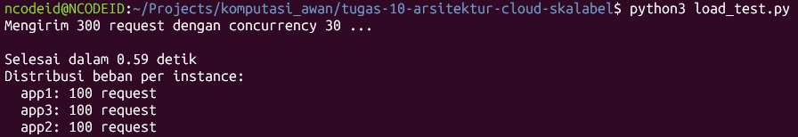
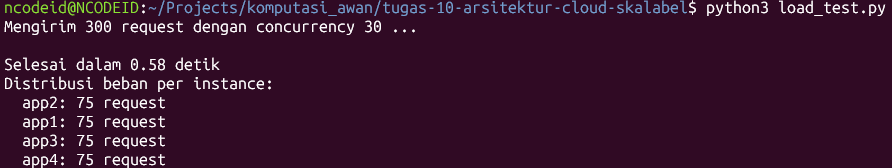
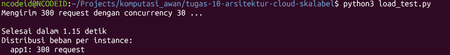

# Jurnal Proses — Tugas 10

## Setup Nginx & multi-instance
- Kendala saat konfigurasi upstream: 
Kendala salah konfigurasi yang membuat load_test.py tidak dapat terhubung pada app tujuan
serta duplicate instance name saat mencoba membuat testing menjadi lebih lama karena perlu menghapus dan run ulang pada Vertical Scaling

## Hasil Load Test Horizontal (3 instance)
Kondisi testing (app1 - app3)
- Distribusi request per instance: 
    - app1 : 100 request.
    - app2 : 100 request.
    - app3 : 100 request.
 

## Hasil Setelah Scale-up (4 instance)
Kondisi testing (app1 - app4)
- Distribusi request per instance: 
    - app1 : 75 request.
    - app2 : 75 request.
    - app3 : 75 request.
    - app4 : 75 request.
 

## Hasil Vertical Scaling (1 instance besar)
Kondisi testing (app_v_scale | menggunakan image dari app1)
- Latensi/kegagalan dibanding horizontal: bertambah jadi 1.15 detik (~ +0.57ms) 
 

## Log Penggunaan AI (Level 2)

> Wajib diisi sesuai kebijakan Level 2 di [`../RUBRIK-UMUM.md`](../RUBRIK-UMUM.md). Tulis "Tidak memakai AI" pada baris pertama jika memang tidak dipakai. Hanya untuk brainstorming ide/outline — bukan untuk kode/analisis/teks akhir.

| Tanggal | Tool AI | Prompt yang diberikan | Ringkasan saran/ide AI | Bagaimana diolah jadi tulisan/kode sendiri |
|---|---|---|---|---|
| Tidak memakai AI | Tidak memakai AI | Tidak memakai AI | Tidak memakai AI | Tidak memakai AI |
