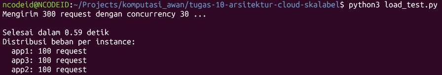
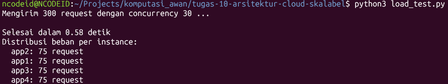
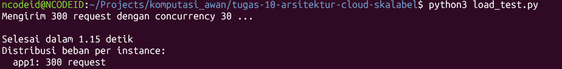

# Tugas 10 (Pekan 10) — Arsitektur Cloud yang Skalabel

**Materi terkait:** Workload Distribution, Resource Pooling, Dynamic/Horizontal/Vertical Scalability, Load Balancing.

## Studi Kasus

Situs web tiket konser "TicketGo" **mogok total** karena tidak mampu menangani lonjakan **1 juta pengguna dalam 1 menit** saat penjualan tiket dibuka (fenomena *thundering herd*). Server tunggal mereka kehabisan koneksi dan CPU 100% dalam hitungan detik.

## Tugas Kelompok

Simulasikan (di laptop, memakai Docker Compose) sebuah arsitektur dengan **Load Balancer** di depan **beberapa instance aplikasi identik**, lalu buktikan dengan load test sederhana bahwa distribusi beban benar-benar terjadi.

### Yang Sudah Disediakan

- `app/app.py` — skeleton server HTTP super sederhana yang mengembalikan ID instance-nya sendiri (supaya kalian bisa melihat request mana ditangani instance mana).
- `nginx/nginx.conf` — skeleton konfigurasi Nginx sebagai Load Balancer, dengan 3 backend (`app1`, `app2`, `app3`).
- `docker-compose.yml` — skeleton yang menjalankan 3 instance `app` + 1 `nginx` sebagai LB.
- `load_test.py` — skeleton script pengirim request konkuren untuk menguji distribusi beban.

### Langkah Kerja

1. Lengkapi `# TODO` di `app/app.py` (kembalikan `INSTANCE_ID` dari environment variable di response).
2. Lengkapi `# TODO` di `nginx/nginx.conf` (buat `upstream` block berisi 3 backend, gunakan di `proxy_pass`).
3. Jalankan:
   ```bash
   docker compose up --build
   ```
4. Lengkapi `load_test.py` untuk mengirim **N request konkuren** (mis. 300 request, 30 thread) ke `http://localhost:8080/`, lalu hitung berapa kali masing-masing instance (`app1`/`app2`/`app3`) menangani request — buktikan beban **terdistribusi**, bukan selalu ke satu instance saja.
5. **Simulasikan scale-up manual**: tambah 1 instance lagi (`app4`) di `docker-compose.yml` + `nginx.conf`, restart, ulangi load test, bandingkan distribusi beban.
6. **Simulasikan Vertical Scaling** untuk perbandingan: jalankan **1 instance saja** tapi beri batas resource lebih besar (`docker run --cpus=2 --memory=1g ...` atau field `deploy.resources` di compose), lakukan load test yang sama, catat latensi/kegagalan dibanding skenario horizontal 3 instance.

## Analisis yang Wajib Ditulis di `README.md`

1. Bukti distribusi beban (angka request per instance) dari load test horizontal.
2. Perbandingan hasil **Horizontal Scaling (3-4 instance kecil)** vs **Vertical Scaling (1 instance besar)** — mana yang lebih tangguh untuk skenario *thundering herd* seperti TicketGo, dan kenapa.
3. Jelaskan **keterbatasan simulasi ini** dibanding *auto-scaling* cloud sungguhan (mis. AWS Auto Scaling Group): di sini kalian menambah instance **manual**, sedangkan cloud asli menambah/mengurangi instance **otomatis berdasarkan metrik** (CPU, jumlah request) tanpa campur tangan manusia. Jelaskan komponen apa yang dibutuhkan agar proses manual kalian bisa jadi otomatis (mis. metric collector + auto-scaler + health check).

## Struktur Submission

```
tugas-10-arsitektur-cloud-skalabel/
├── README.md
├── JURNAL.md
├── docker-compose.yml
├── app/
│   └── app.py
├── nginx/
│   └── nginx.conf
├── load_test.py
└── bukti/          # Output load test (horizontal vs vertical), screenshot docker compose ps
```

## Rubrik Penilaian (Tugas 10)

| Komponen | Bobot | Kriteria |
|---|---|---|
| LB & multi-instance berjalan | 30% | Nginx berhasil mendistribusikan request ke ≥3 instance berbeda |
| Load test & bukti distribusi | 25% | Angka konkret request per instance, bukan klaim tanpa data |
| Analisis Horizontal vs Vertical | 25% | Perbandingan berbasis hasil eksperimen sendiri, bukan teori generik |
| Analisis keterbatasan vs auto-scaling nyata | 10% | Paham perbedaan simulasi manual vs mekanisme otomatis di cloud asli |
| Proses & kontribusi kelompok | 10% | `JURNAL.md`, commit history |

## Batasan Penggunaan AI (Level 2)

Kebijakan **Level 2 (AI Assisted Idea Generation & Structuring)** berlaku — lihat [`../RUBRIK-UMUM.md`](../RUBRIK-UMUM.md). Boleh bertanya konsep umum load balancing ke AI; **tidak boleh** meminta AI menuliskan isi `# TODO` di `app/app.py`, `nginx/nginx.conf`, atau `load_test.py`. Catat pemakaian AI di "Log Penggunaan AI" pada `JURNAL.md`.

- `JURNAL.md` wajib mencatat apa yang terjadi jika satu instance `app` dimatikan saat load test berjalan (jalankan skenario ini dan catat hasilnya, jangan cuma diklaim tanpa data).


## Hasil Analisis Kelompok

### 1. Bukti distribusi beban dari load test horizontal:
Berikut merupakan bukti distribusi beban: <br/>


Scale Up:<br/>


### 2. Perbandingan Horizontal Scaling dengan Vertical Scaling:
Berdasarkan hasil pengujian (300 request, concurrency 30), Horizontal Scaling (3–4 instance kecil) terbukti jauh lebih tangguh untuk skenario thundering herd seperti TicketGo, dengan waktu eksekusi 2x lebih cepat (0.58 detik vs 1.15 detik).

Bukti:<br/>

<br/>vs<br/>
